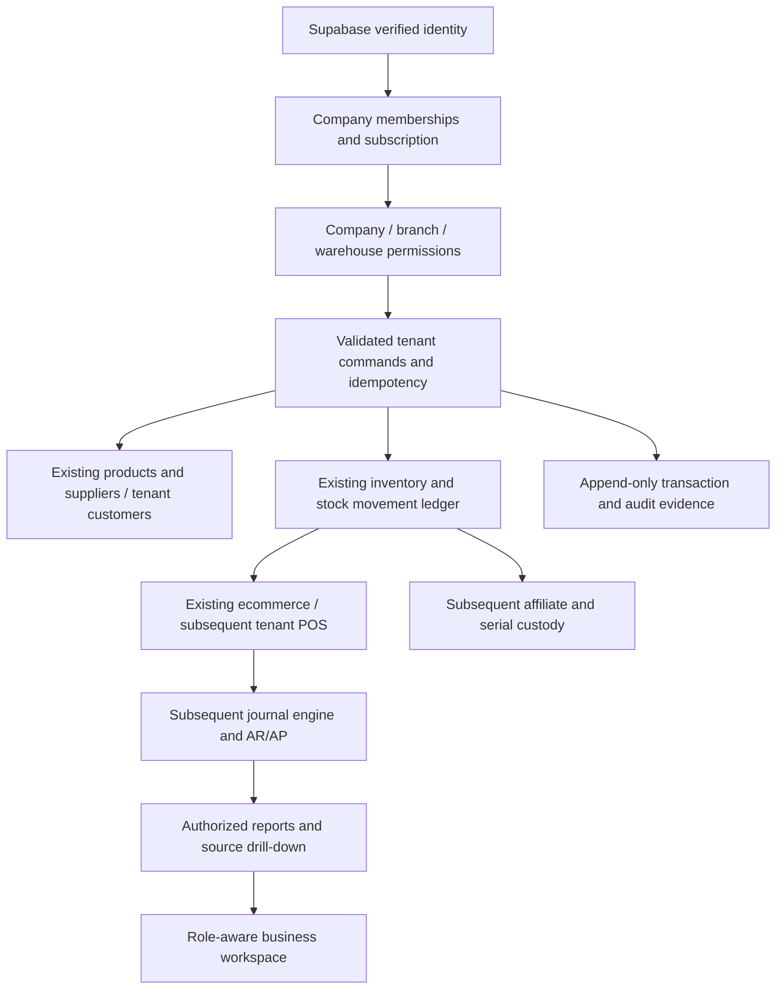

# Business operating system upgrade

17 November 2026. Preserve the existing application and deploy incrementally.

## Phase 0: evidence and boundaries

The repository contains Next.js 16.4.6, React 19.3, TypeScript, Zod, Tailwind/CSS and lucide-react. The backend is Next route handlers plus transactional PostgreSQL RPCs. Supabase provides Auth, PostgreSQL RLS and Storage. Prices use integer kobo (`bigint`), which is exact fixed-point money; retain this convention rather than introduce floating-point currency. Paystack is confirmed on the server, including amount, currency, provider identity and recipient. Billing is separate from commerce. Node 24 deployment packaging targets standalone hosting; SaaS has its own project preflight. Existing Android/Windows wrappers consume the hosted app.

Inspected `src/app`, components, libraries, API routes, all migration filenames and domain definitions, test harnesses, deployment scripts and existing architecture/release documents. Existing documentation describes several different release dates; source and executable database tests take precedence over historical completion claims.

The schema has 62 sequential migrations before this upgrade. `products`, `suppliers`, `purchase_orders`, `orders`, `stock_movements`, reservations and payments already exist. Reuse them. Tenant inventory, branch/warehouse scope, memberships and executor roles were added in 052–055. The flagship remains routed through its working legacy operations; do not open new tenant records through legacy admin RPCs. Global Auth profiles are identities, not an editable tenant customer address book. Field outlets are operational visits, not a replacement for the customer master.

The designated SaaS database preflight (`node --use-system-ca scripts/saas-database.cjs --check`) refused the local database configuration before connecting because it did not match the configured SaaS project. Therefore no live schema, migration state, backups, production record counts or service configuration are claimed verified. Reconstruct and test the migration chain in isolated PGlite now; hosted inspection remains a release gate. Never silently connect to the flagship instead.

See [FEATURE-PARITY.md](FEATURE-PARITY.md) for each requested feature, reusable implementation, gaps, database/backend/frontend/integration changes and tests. This matrix predates implementation; release notes record verified increments separately.

## Architecture

Use explicit new entrypoints under the private tenant executor with function-local tenant settings, composite tenant foreign keys, server-side validation and RLS. Do not treat a browser tenant selector as authority. New command receipts contain the original actor, action, payload and result; retries must match all four boundaries. Mutable master records and immutable posted evidence have different retention rules.

## Controlled delivery and acceptance gates

0. Audit, matrix, architecture and recovery plan (this document).
1. Core foundation: product identifiers/cost/supplier, tenant customer and supplier management, stock availability, immutable/retry-safe movement commands and scoped operational overview. Preserve current permissions and branch architecture.
2. Tenant POS: reuse existing sale/receipt graph after tenant migration; server prices, split tenders, credit, returns, shifts and durable offline synchronization. Accept cash, credit, split, partial/full payments and interrupted replay before proceeding.
3. Finance: balanced immutable journals and reversals first, then AR/AP/expenses/reconciliation and source-linked financial reports. No profit figure until cost recognition exists.
4. Affiliate custody: release/acknowledge/sell/remit/inspect-return and distinct custody/receivable/commission balances.
5. Advanced inventory: individual serials/IMEIs, batch/expiry, approvals/transfers, bins and evidence-based reorder forecasts.
6. Procurement/fulfilment: reuse supplier/PO/order graph with lines, approvals, verified partial receiving, picks/packs/shipments.
7. CRM/workforce: history, loyalty/consent, staff/department/shift/commission workflows.
8. Provider abstraction/integrations: independently verified adapters, signed events, reconciliation, controlled delivery retries. Real provider credentials and hosted acceptance required.
9. AI/workflows: read-only authorized reporting with provenance; explicit human approvals for financial and inventory changes. No autonomous financial action.
10. Design/performance/security: refine each delivered module throughout all phases; finish cross-module keyboard/mobile/accessibility, hosted load and backup recovery acceptance here.

Each phase needs database hostile tests, API authorization/validation, real app browser acceptance and regression checks before its successor is marked complete. The requested 28 acceptance workflows map to phases 1–10; an unimplemented workflow remains pending, never substituted by a UI mock. No full-platform, vendor-parity, capacity, banking, tax or e-invoice compliance claim is made.

## Backup, migration and rollback

Before hosted migration, export source commit/hash and private runtime configuration, take a consistent database backup plus Storage manifest, checksum it and restore into an isolated project. Verify record counts, tenant ownership, RLS, reservations, payments and representative business flows. Supply the existing migration evidence file with the exact target hash and successful restore within 24 hours; the migrator already checks these requirements. Do not weaken that gate.

Use additive migration 063 onward, retain prior applied files byte-for-byte, run the full chain against isolated PostgreSQL fixtures, then perform the designated-project dry run and hosted staging verification. Deploy the old UI first during rollback and hide new entrypoints; retain new master and movement evidence. After transactions occur, prefer a forward fix. Never drop new records or restore an old snapshot over later sales. Reconcile movements by command receipt IDs; use compensating movements and subsequent accounting reversals, not deletion. Production deployment, DNS, shared webhooks, real charges/refunds and database migration have not been performed by this upgrade.
